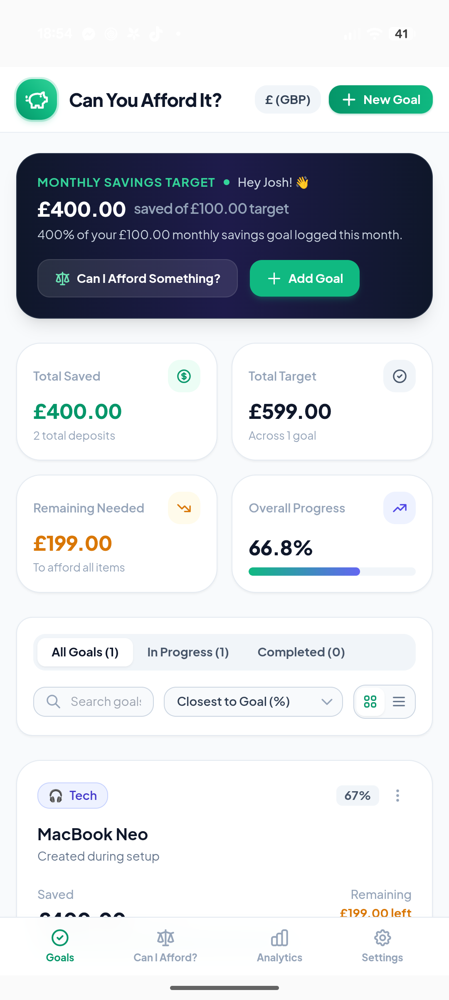

# 🎯 Can You Afford It? (Savings Tracker & Decision Engine)

> **A smart, minimalist personal savings tracker and purchase decision engine designed to help you set financial goals, log deposit progress, and answer the critical question: *"Can I afford this right now?"***

[](https://developer.android.com/)
[](LICENSE)
[](dist/CanYouAffordIt-v1.0.apk)

---

## 🤖 AI Declaration & Disclosure

> [!IMPORTANT]
> ### **AI ASSISTANCE DECLARATION**
> **This application, its source code, architecture, user interface, and accompanying documentation were developed with the assistance of Artificial Intelligence (Google DeepMind / Antigravity Agentic AI Assistant) in collaboration with the project author.**
>
> **Scope of AI involvement:**
> - **Architecture & Engineering:** Web application structure, Jetpack Compose Android WebView wrapper, and offline-first storage mechanisms.
> - **Frontend & UX Design:** Responsive UI layouts designed with Tailwind CSS, custom color palettes, fluid transitions, and accessibility attributes.
> - **Financial Logic:** Formulation of the *Affordability Decision Engine*, "Hours of Life / Work" wage calculator, savings velocity algorithms, and impulse purchase cooldown timers.
> - **Build Engineering:** Gradle build automation, signed APK generation, and release packaging.

---

## 📸 App Preview

<p align="center">
  
</p>

---

## ✨ Key Features

### 1. 🎯 Goal Dashboard (Card & List Views)
- **Scannable Wishlist**: View your wishlist items in either a modern **Card Grid** or a sleek **List View**.
- **Metrics at a Glance**:
  - Saved vs. Target amount formatted in your chosen currency (e.g. `£220.00 / £350.00`).
  - High-contrast animated progress bars with exact percentage completed.
  - Remaining balance needed to reach the goal.
  - Priority badges (`High`, `Medium`, `Low`) and optional target deadlines (`Target: Dec 2026`).
  - External product link preview (`View product ↗`).
- **Quick-Add Button (`+ Add Savings`)**: 1-click quick modal to log deposits (or correct mistakes) with preset quick-chips (`+10`, `+25`, `+50`, `+100`, or `Fill Remaining`).
- **Pace Summary Banner**: Tracks your total savings across all goals against your personal monthly budget target.

### 2. ⚖️ "Can You Afford It?" Decision Engine
The signature core tool answering: *"Can I afford this right now?"*
- Select from your tracked wishlist goals or type any impulse purchase name and price.
- Cross-references your total savings pool, monthly savings rate, and hourly wage.
- **Dynamic Verdicts**:
  - 🟢 **YES, AFFORDABLE**: Safe to purchase outright without touching emergency buffers.
  - 🟡 **ALMOST THERE**: Within 70%+ of target; shows exact remaining shortfall and estimated weeks.
  - 🔴 **NOT YET**: Shows the shortfall, estimated date when it will be affordable at your current rate, and a 1-click button to **+ Save as New Goal**.
- **Life Energy (Hours of Work)**: Calculates the real cost in working hours (e.g., *"This costs 15.6 hours of your life"*).
- **30-Day Cool-off Timer**: Recommends a 24h, 48h, 7-day, or 30-day waiting period tailored to price tier to eliminate buyer's remorse.

### 3. 🚀 Setup & Onboarding Wizard
- First-time interactive guide to establish:
  1. Your name / nickname.
  2. Primary currency (`£` GBP, `$` USD, `€` EUR, `¥` JPY, `C$` CAD, `A$` AUD, `CHF`).
  3. Monthly savings budget and hourly take-home wage.
  4. Your very first savings goal (with starter templates for Headphones, Travel, Emergency Fund, Tech).
- Can be re-launched anytime from **Settings → Launch Setup Wizard**.

### 4. 📊 Analytics & Master Ledger
- **Savings Velocity**: Average savings rate per week and month.
- **Milestone Completion Rate**: Percentage of funded vs active goals.
- **Finish Date Forecast**: Projected date when all active goals will be completed based on your savings pace.
- **Category Allocation**: Visual breakdown of funds across categories (*Tech*, *Travel*, *Home*, *Fashion*, *Fitness*, *Gifts*, *Other*).
- **Unified Transaction Ledger**: Chronological history of every deposit made across all items with date, amount, and notes.

### 5. 🛡️ Goal Completion State & Audio Chime
- Items reaching 100% display a green **Goal Reached! 🎉** badge, celebratory glowing pulse, and are grouped in the *Completed* tab.
- Integrated multi-burst **Confetti celebration** (via Canvas Confetti).
- Subtle harmonic chime synthesized in-browser via the **Web Audio API** (zero external audio file dependencies).

### 6. 💾 Local Storage & Portability
- **100% Offline & Private**: All data is automatically saved in `localStorage` under `canyouaffordit_savings_data_v1` and `canyouaffordit_user_profile_v1`.
- **JSON Backup & Restore**: One-click export and import of your entire financial profile and transaction ledger.

---

## 📱 Pre-Built APK Downloads

The Android APK is compiled, signed, and ready for installation:

| Build Type | File Path | Size | Description |
|:---|:---|:---|:---|
| **Production Release** | [`dist/CanYouAffordIt-v1.0.apk`](dist/CanYouAffordIt-v1.0.apk) | **~856 KB** | Highly optimized, ProGuard/R8 shrunk, signed with universal cert |
| **Debug Build** | [`dist/CanYouAffordIt-v1.0-debug.apk`](dist/CanYouAffordIt-v1.0-debug.apk) | **~11.7 MB** | Unminified build with full debugging symbols |

### How to Install the APK on Android
1. Transfer or download `CanYouAffordIt-v1.0.apk` to your Android phone or tablet.
2. Tap the downloaded `.apk` file.
3. If prompted, allow *"Install unknown apps"* for your browser or file manager.
4. Tap **Install** and open **Can You Afford It?**.

---

## 🌐 Running as a Web Application

You can also run the web app directly in any modern browser without installing anything:

```bash
# Simply double-click index.html or serve it with Python / Node
python -m http.server 8080
```
Then open `http://localhost:8080` in your web browser.

---

## 🛠️ Tech Stack & Architecture

- **Mobile Client**: Android (API 24 to 37 / Android 17), Jetpack Compose, Kotlin, Android WebView (`domStorageEnabled = true`, `allowFileAccess = true`).
- **Frontend**: HTML5, Vanilla ES6+ JavaScript, Tailwind CSS (CDN/JIT), Google Fonts (Plus Jakarta Sans & Inter).
- **Interactive Libraries**: Canvas Confetti, Web Audio API harmonic oscillator, PWA Web App Manifest (`manifest.json`).
- **Data Layer**: Browser DOM LocalStorage with JSON backup export/import.

---

## 📂 Project Structure

```
Canyouaffordit/
├── app/                               # Android Application Module
│   ├── src/main/
│   │   ├── java/com/example/canyouaffordit/
│   │   │   └── MainActivity.kt        # Jetpack Compose Edge-to-Edge WebView container
│   │   ├── assets/
│   │   │   ├── index.html             # Bundled offline application
│   │   │   └── manifest.json          # PWA metadata
│   │   └── AndroidManifest.xml        # Permissions & activity configuration
│   └── build.gradle.kts               # Android & dependencies config
├── dist/                              # Ready-to-publish APK builds
│   ├── CanYouAffordIt-v1.0.apk        # Signed release APK (~856 KB)
│   └── CanYouAffordIt-v1.0-debug.apk  # Debug APK
├── screenshots/
│   └── app_preview.png                # Device screenshot
├── index.html                         # Standalone web application
├── manifest.json                      # Web App Manifest
└── README.md                          # Comprehensive project documentation
```

---

## 🔨 Building from Source

To build the APK yourself using Gradle:

```bash
# Debug APK
./gradlew assembleDebug

# Release APK
./gradlew assembleRelease
```
The output APKs will be generated in `app/build/outputs/apk/`.

---

## 📄 License

This project is licensed under the [MIT License](LICENSE).
Feel free to customize, share, and expand upon it!
